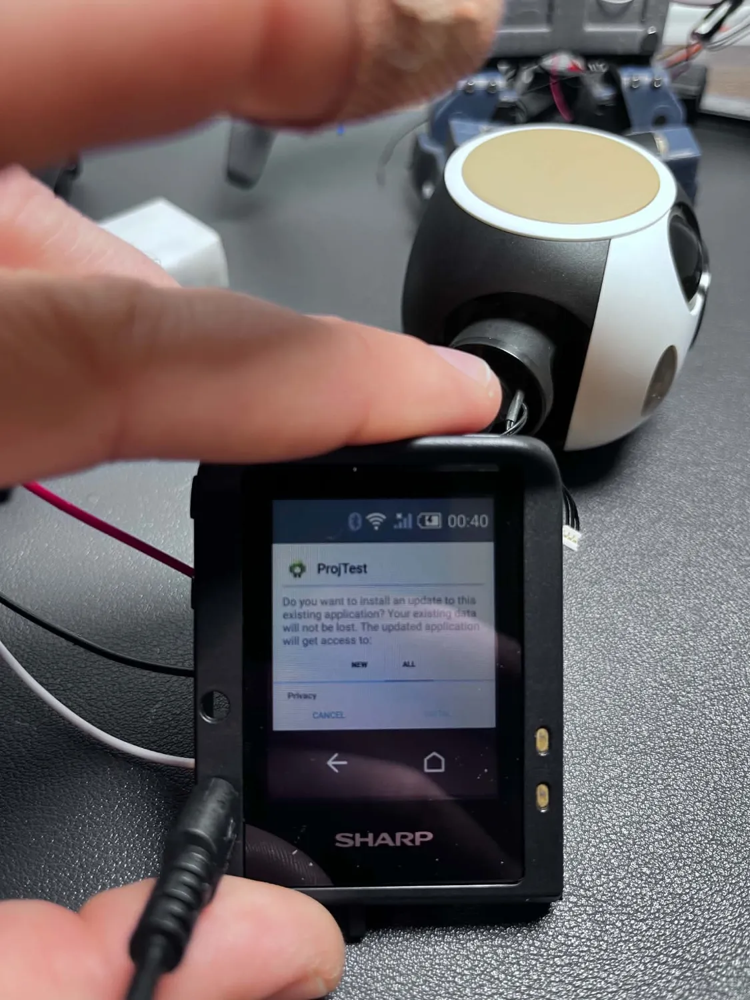

# RoBoHoN OG Head

Brings a salvaged RoBoHoN head back to life as a standalone unit: an Android
app that takes over RoBoHoN's own Android board (home screen, camera,
projector, colour-blob tracking), plus ESP32 firmware that drives the head's
neck servos to follow the tracked target.

| Folder | What it is |
|---|---|
| `android/ProjTest/` | Android app for RoBoHoN's board: replaces the home launcher, starts on boot, camera and projector test screens, `TrackActivity` colour-blob tracker, servo probe/move screens |
| `android/RobohonAutoSkip/` | Accessibility service that taps "Skip" on RoBoHoN's initial-setup screen at boot |
| `firmware/NeckTrack/` | ESP32-S3: receives the tracker's centroid over Wi-Fi UDP (port 8888) and pans the neck to keep the target centered |
| `firmware/NeckJog2/` | ESP32-C3 serial tester: moves one head-bus servo at a time, clamped to measured limits |
| `firmware/NeckJogBB/` | ESP32-C3 bit-bang head-bus tester |
| `firmware/ServoRelax/` | Sends the two-stage relax sequence so the head servos go limp |

## How tracking works

`TrackActivity` follows a colour in the camera image and broadcasts the
centroid as `x,y` (each -1000..+1000 from frame center) over UDP to
255.255.255.255:8888, about 25 times a second. `NeckTrack` listens on the same
LAN and drives SID 1 (neck turn) on the head bus.

## Head servo bus

115200 baud, 8N1, TX only, idle high. 30-byte frames
`77 80 00 03 06 00 | [pos_lo pos_hi flag sid] x 5 | trailer | checksum`.
SID 1 = neck turn, SID 2 = head nod, SID 3 = head tilt.

## Setup

- `firmware/NeckTrack/`: copy `secrets.example.h` to `secrets.h` and enter your
  Wi-Fi network (git-ignored), then upload with the ESP32 Arduino core.
- Android apps: open each folder in Android Studio and install to the RoBoHoN
  board over ADB. `ProjTest` uses RoBoHoN's projector permission, so it only
  works on RoBoHoN hardware.

RoBoHoN is a trademark of Sharp Corporation. This project is not affiliated
with Sharp.

## License

MIT. See [LICENSE](LICENSE).
